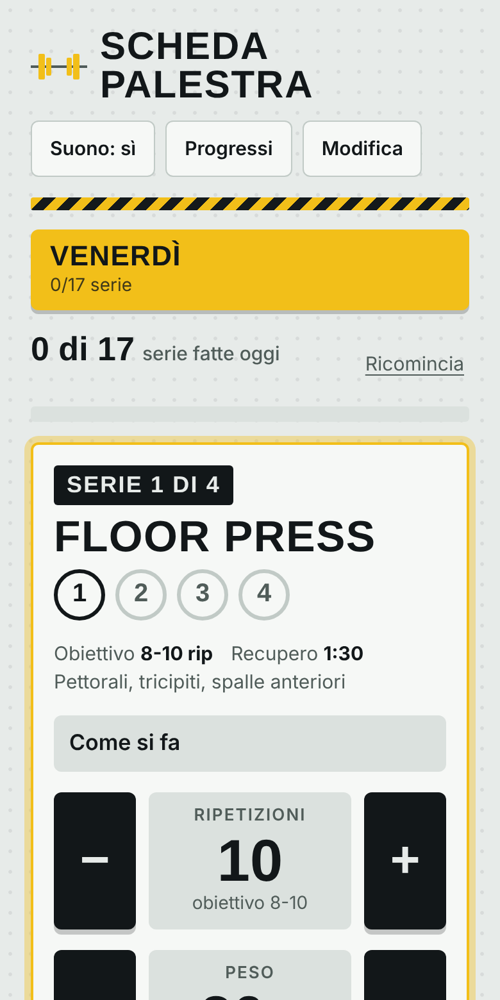
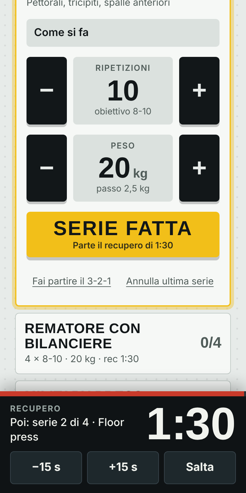
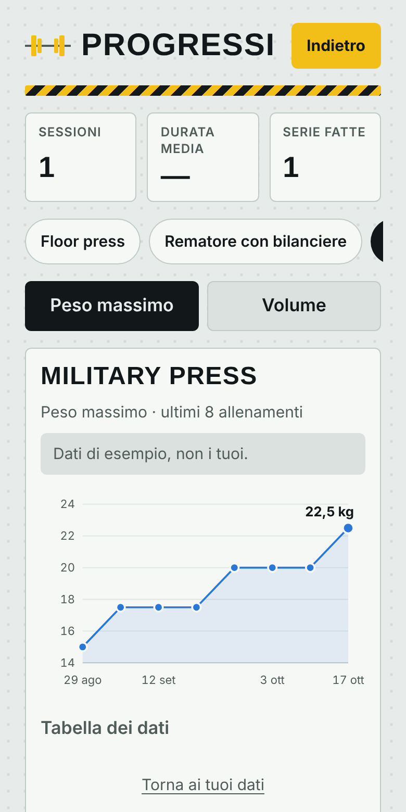

<p align="center">
  
</p>

<h1 align="center">Scheda Palestra</h1>

<p align="center">
  La scheda per allenarsi a casa: cosa fare, quante serie, quante ripetizioni, quanti kg, e un cronometro che ti avvisa quando il recupero è finito.<br>
  Un solo file HTML, nessuna installazione, funziona anche senza rete.
</p>

<p align="center">
  
  
  
</p>

## Cosa fa

- **Scheda del giorno**: esercizi, serie, ripetizioni, kg e recupero. Un tocco su "Serie fatta" e parte il recupero.
- **Cronometro del recupero** con avviso a fine tempo (suono, vibrazione, lampo verde) e tasti ±15 s. Il tempo non si perde se chiudi la pagina.
- **Ripetizioni reali**: per ogni serie scegli quante ne hai fatte con i tasti − e +, già impostate sull'obiettivo.
- **Ultima volta e progressione**: ti mostra cosa hai fatto l'ultima volta e, se hai chiuso tutte le serie al massimo delle ripetizioni, ti propone di salire di peso con un tocco.
- **Serie a tempo**: per plank e isometrici, conto alla rovescia 3-2-1 e poi il cronometro conta la serie.
- **Riscaldamento** facoltativo prima della prima serie.
- **Superserie**: due esercizi di fila senza recupero in mezzo (curl + tricipiti, per esempio).
- **Durata dell'allenamento** dalla prima serie all'ultima.
- **Grafico dei progressi** per ogni esercizio: peso massimo o volume nel tempo, con tabella dei dati.
- **Modifica** completa: giorni, esercizi, serie, ripetizioni (anche "8-10"), kg, recupero, muscoli e descrizione "Come si fa".
- Tema scuro e chiaro automatici, animazioni (spente se il telefono chiede meno movimento).

La scheda di partenza è quella del venerdì: floor press, rematore con bilanciere, military press, stacco da terra e superserie braccia. I kg iniziali sono provvisori (20 kg per il bilanciere, 8 kg per i manubri): regolali dal tasto − / + e l'app li ricorda.

## Usarla

### Online con GitHub Pages

1. Crea un repository su GitHub e carica tutti questi file.
2. Vai in **Settings → Pages** e come *Source* scegli **GitHub Actions**.
3. Dopo il primo push su `main` il workflow `Pubblica su GitHub Pages` pubblica il sito su `https://<tuo-utente>.github.io/<nome-repo>/`.

### In locale

Apri `index.html` nel browser. Per provare anche il service worker (uso offline) serve un piccolo server:

```bash
python3 -m http.server 8000
# poi apri http://localhost:8000
```

### Come app sul telefono

- **iPhone**: Safari → Condividi → *Aggiungi alla schermata Home*.
- **Android**: Chrome → menu ⋮ → *Installa app* (o *Aggiungi a schermata Home*).

Una volta installata si apre a schermo intero e funziona anche offline.

## I tuoi dati

Scheda, storico e progressi sono salvati **sul dispositivo**, nel `localStorage` del browser. Non c'è nessun server e nessun account. Se cancelli i dati del sito perdi lo storico, e su un altro telefono ripartirai dalla scheda di esempio.

## Limiti da conoscere

- Con il telefono bloccato il browser può sospendere la pagina: il suono di fine recupero può arrivare in ritardo o non arrivare. L'app tiene lo schermo acceso mentre il cronometro corre (dove il browser lo permette), quindi in allenamento lascialo sbloccato.
- Il suono parte solo dopo il primo tocco sulla pagina (regola dei browser).
- I font (Big Shoulders Display e Barlow Semi Condensed) arrivano da Google Fonts; senza rete l'app usa font di sistema simili e funziona uguale.

## Struttura

```
index.html            tutta l'app (HTML, CSS e JavaScript, senza dipendenze)
manifest.webmanifest  dati per installarla come app
sw.js                 service worker: uso offline
icons/                icona (SVG e PNG, anche "maskable" per Android)
docs/                 screenshot e immagine di anteprima per GitHub
.github/workflows/    pubblicazione automatica su GitHub Pages
```

Per cambiare la scheda di partenza modifica la funzione `seedPlan()` dentro `index.html`. Quando pubblichi una nuova versione cambia `VERSION` in `sw.js`, così i telefoni scaricano i file aggiornati.

## Immagine di anteprima

Su GitHub vai in **Settings → General → Social preview** e carica `docs/social-preview.png`: sarà l'immagine che appare quando condividi il link del repository.

## Licenza

MIT, vedi [LICENSE](LICENSE). Scrivi il tuo nome nella riga del copyright.
